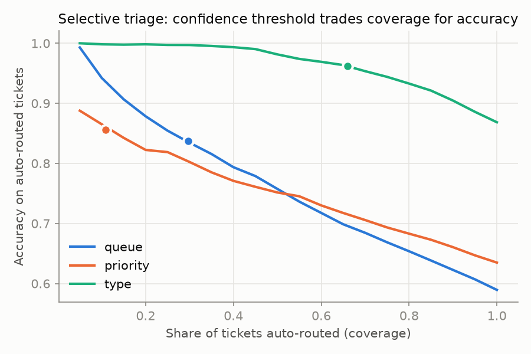
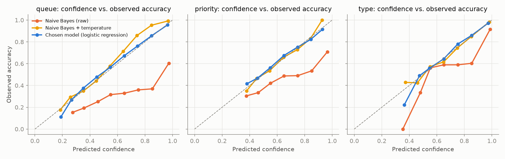
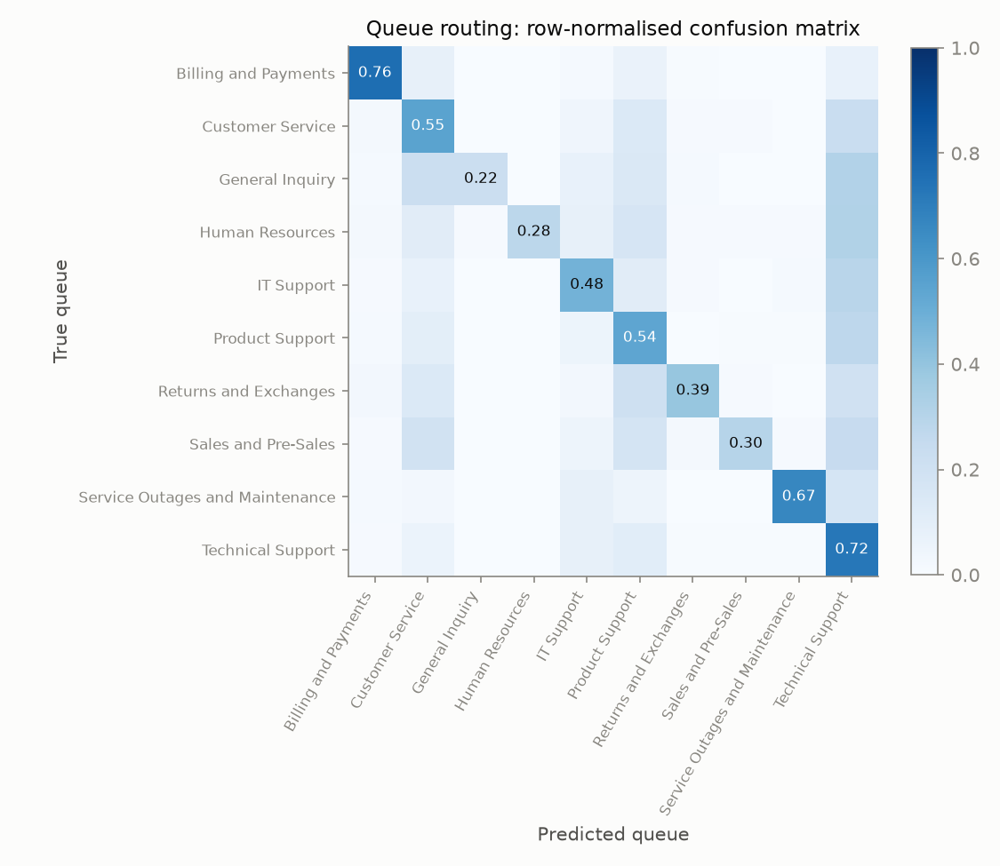
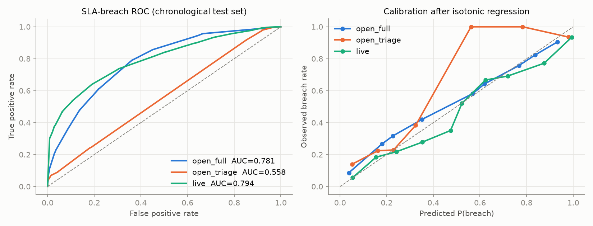
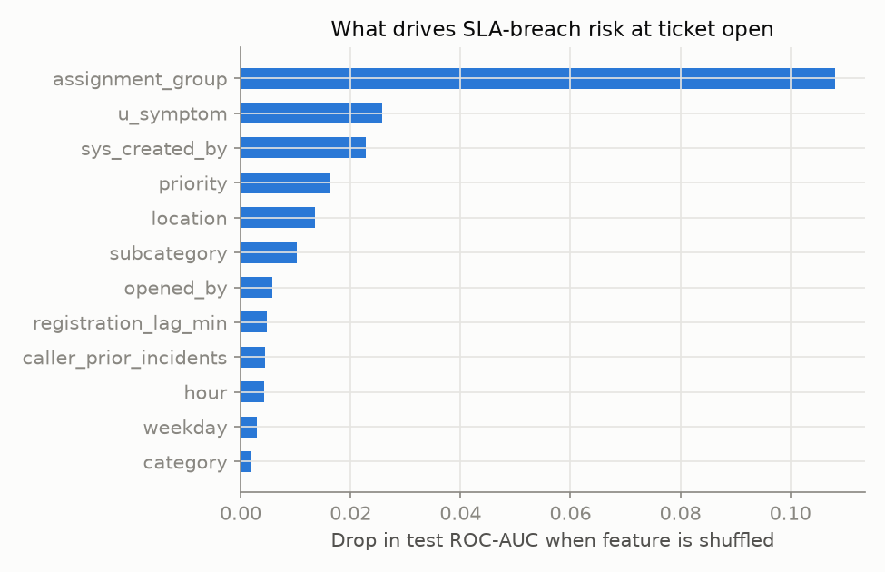

# Results — Probabilistic NLP Support Triage & SLA Risk Prediction

All numbers are on held-out test data. Triage: stratified 70/10/20 split. SLA: chronological 70/10/20 split on `opened_at` (train on the past, test on the future).

## 1. Probabilistic triage (ticket text → queue / priority / type)

| Target | Classes | Majority baseline | Naive Bayes acc | LogReg acc | Chosen | Macro-F1 | ECE raw → calibrated | Auto-routed | Accuracy when auto-routed | Accuracy sent to human |
|---|---|---|---|---|---|---|---|---|---|---|
| queue | 10 | 0.292 | 0.479 | 0.589 | logistic regression | 0.545 | 0.013 → 0.021 | 29.6% | 0.838 | 0.485 |
| priority | 3 | 0.401 | 0.554 | 0.635 | logistic regression | 0.617 | 0.055 → 0.021 | 10.8% | 0.856 | 0.608 |
| type | 4 | 0.405 | 0.838 | 0.868 | logistic regression | 0.872 | 0.011 → 0.010 | 65.9% | 0.962 | 0.688 |

Naive Bayes is strongly over-confident (queue ECE 0.363); temperature scaling (T = 4.11) fixes it (ECE 0.024). Logistic regression is close to calibrated out of the box.

### Most indicative terms per queue

- **Billing and Payments**: billing, payment, sie details, management support, growth thank, on optimizing, hospital it, data which
- **Customer Service**: analytics data, marketing strategies, elasticsearch security, sie bitte, investment performance, project performance, for user, experiencing problems
- **General Inquiry**: on medical, security data, serverprobleme, security solutions, the server, data security, support team, product inquiry
- **Human Resources**: employee, hr, data compromise, provide details, quickbooks software, breach detected, secure storage, the software
- **IT Support**: in project, numtoken and, digital tools, analytics dashboard, and engagement, of digital, protocols to, teams and
- **Product Support**: restarting systems, api changes, management api, strategies through, the team, to integration, zur optimierung, firmware
- **Returns and Exchanges**: returns, security details, für data, security in, supply comprehensive, brand engagement, digital strategies, models
- **Sales and Pre-Sales**: sales, digital brand, firebase saas, improve data, solutions, analytics could, tools improve, lösungen
- **Service Outages and Maintenance**: service, maintenance, disruption, service outage, support downtime, aws monday, improve medical, outages
- **Technical Support**: growth and, investment metrics, optimization thank, data discrepancies, experiencing issues, and access, digital tools, to recent

## 2. SLA-breach risk (ServiceNow incident log)

Overall breach rate: 39.4%. Breach rate by priority (Beta(1,1)-smoothed): 1 - Critical: 80.5%, 2 - High: 96.9%, 3 - Moderate: 39.0%, 4 - Low: 17.0%

| Model | When it is used | Chosen | ROC-AUC | PR-AUC | Brier | ECE before → after isotonic | Priority-only rule AUC | Test base rate |
|---|---|---|---|---|---|---|---|---|
| open_full | ticket opened, ITSM fields known | gradient boosting | 0.781 | 0.495 | 0.144 | 0.098 → 0.060 | 0.547 | 22.3% |
| open_triage | ticket opened, only text-triage priority + time + workload | gradient boosting | 0.558 | 0.281 | 0.171 | 0.180 → 0.059 | 0.547 | 22.3% |
| live | every update while still within SLA | gradient boosting | 0.794 | 0.780 | 0.183 | 0.240 → 0.057 | 0.531 | 45.1% |

Risk bands on the open-time test set (does a HIGH band really breach more?):

| Band | Tickets | Observed breach rate |
|---|---|---|
| LOW | 3529 | 16.7% |
| MEDIUM | 519 | 48.4% |
| HIGH | 106 | 82.1% |

## 3. Honest limitations

- The ticket-text dataset is synthetic (LLM-generated, stated on Kaggle); its labels are noisy, which caps queue accuracy near 60%. That is why the system abstains and hands low-confidence tickets to a human.
- The two datasets are different organisations. They are linked only through priority (low→4-Low, medium→3-Moderate, high→2-High), an explicit assumption in `src/config.py`.
- With priority alone, SLA risk is only weakly predictable (open_triage AUC above). The useful signal comes from routing context: assignment group, symptom, location. Supply them when known.
- The incident log's categories and groups are anonymised IDs (e.g. 'Group 56').
- The commonly used Kaggle 'Customer Support Ticket Dataset' (suraj520) was evaluated and rejected: text models scored at chance (Ticket Type 19.4% vs 20.7% majority) and 49% of its resolution timestamps precede the first response, i.e. the labels are random.
